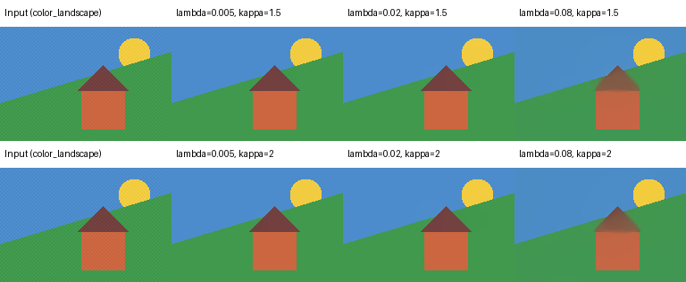
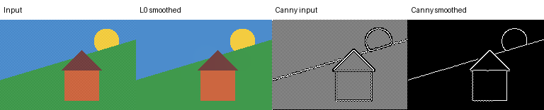
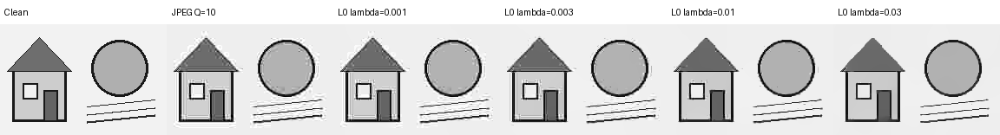
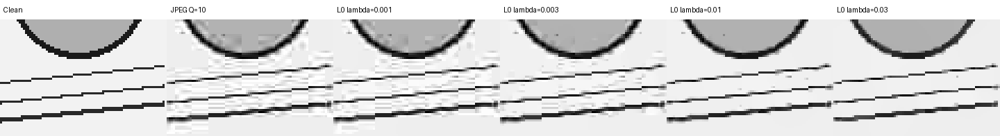

# 基于 L0 梯度最小化的图像结构平滑与边缘提取

媒体计算课程大作业 · 第 4 题

作者：蒋天乐

日期：2026 年 11 月 14 日

## 1. 完成内容

本项目复现 L0 梯度最小化的核心算法，实现灰度和彩色图像结构平滑、参数控制、
同参数边缘提取，以及 Clip-art JPEG 压缩伪影处理。输入、输出、运行参数、迭代次数和耗时
随实验保存，另提供命令行运行包、参数复现和离线交互 Demo。
后续补充 Streamlit 现场计算 Demo，可在页面调整参数、上传图像、查看局部及下载当前结果。

算法中的周期差分、颜色通道联合阈值、FFT 闭式更新和交替优化均在本项目中实现。
NumPy 用于数组及 FFT，Pillow 用于图像读写与 JPEG 编码，OpenCV 用于基础 Canny、
颜色转换和高斯滤波。未调用完整 L0 平滑接口，也未复制作者的完整实现。

## 2. 算法原理及其与代码的对应

### 2.1 优化目标

给定归一化输入图像 I，输出 S。采用周期边界的水平、垂直前向差分 Dx、Dy，
非零梯度计数按像素位置计算：同一像素只要有任意通道、任意方向不为零就计一次。

$$
C(S)=\#\{p\mid\sum_c(|D_xS_{p,c}|+|D_yS_{p,c}|)\ne0\},
\qquad \min_S\|S-I\|_2^2+\lambda C(S).
$$

保真项限制输出偏离输入；稀疏项限制发生变化的位置数，而非直接惩罚大梯度的幅值。
这使较小的纹理梯度有机会被消除，同时保留较强的结构边界。lambda 控制两项之间的平衡。
该问题含有离散计数，不能直接按普通光滑目标求导优化。

### 2.2 半二次分裂与交替更新

引入 h、v 逼近 DxS、DyS，优化保真项、梯度一致性惩罚及 C(h,v)。
固定 S 时，比较将一个像素的全部辅助梯度置零与保留原梯度的代价。
令 q 为该像素全部颜色通道、两个方向梯度平方和：

$$
q_p=\sum_c((D_xS_{p,c})^2+(D_yS_{p,c})^2).
$$

若 q <= lambda/beta，则该像素 h、v 的全部通道都置零；否则保留 DxS、DyS。
不能逐通道分别阈值，否则对应的计数模型会改变。

固定 h、v 时，S 满足线性方程：

$$
[\operatorname{Id}+\beta(D_x^*D_x+D_y^*D_y)]S
=I+\beta(D_x^*h+D_y^*v).
$$

周期差分可在傅里叶域对角化，因此每个通道的更新为：

$$
\widehat S_c=\frac{\widehat I_c+\beta(\overline d_x\widehat h_c+\overline d_y\widehat v_c)}
{1+\beta(|d_x|^2+|d_y|^2)}.
$$

代码先计算差分伴随，再做 FFT，与分子中的共轭频率响应乘积等价。
从 S=I、beta=2lambda 开始交替更新，每轮令 beta 乘以 kappa，达到 beta_max 后停止。
默认 kappa=2、beta_max=100000。循环内部不裁剪像素，避免改变二次子问题；
只在生成显示 PNG 时裁剪并量化，原始浮点数组可单独保存。

| 数学步骤 | 代码位置 | 关键检查 |
|---|---|---|
| 周期前向差分 | `l0_smoothing.core.periodic_gradient` | 最后一列／行与第一列／行连接 |
| 差分伴随 | `l0_smoothing.core.gradient_adjoint` | 内积恒等式与符号 |
| 颜色及方向联合阈值 | `l0_smoothing.core.joint_threshold` | 全通道共用一个掩码，等号处置零 |
| FFT 分母 | `l0_smoothing.core.difference_spectrum` | 两个方向的频率响应平方和 |
| 固定 h、v 的闭式解 | `l0_smoothing.core.fft_update` | 与独立稠密线性方程求解对照 |
| 交替优化 | `l0_smoothing.smooth` | 初始化、参数递增及终止条件 |

### 2.3 算法复杂度与验证

设 N 为像素数、C 为通道数、T 为迭代数，主要时间复杂度约为 O(TCN log N)，
主要内存开销为 O(CN)。kappa 越接近 1，迭代通常越多。
输入 FFT 和差分频谱在循环外预计算。实验中 lambda=0.02、kappa=2 时迭代 22 次；
kappa=1.5 时迭代 37 次。非凸优化可能得到不同局部结果，不能保证更慢就一定更好。

验证包含手算周期边界、伴随内积、彩色联合阈值、独立构造的 3×5 稠密线性系统、
常量图像、非方形与单行／单列图像、均值保持、输入不变及可重复性。
纹理阶跃测试还要求平坦区波动减小，且主边界两侧亮度差保留到 0.4 以上。

## 3. 数据、参数和运行方法

### 3.1 输入数据与预处理

第 4 节的批量实验输入为项目自制插画，无随机生成步骤。
结构平滑使用 192×128 的灰度阶跃、彩色风景和几何图形，在平坦结构上叠加幅度 0.025 的周期纹理。
JPEG 实验使用干净彩色风景及含房屋、圆形、1／2／3 像素斜线的灰度线条图。
生成方法和来源分别记录于 `data/illustrations/README.md`、`data/clipart/README.md`。

交互 Demo 另提供五张外部真实照片，以及论文作者公开的海滩、岩石原图，来源分别见
`data/photos/README.md` 和 `data/paper_examples/README.md`。论文样例按原尺寸计算，
以 λ=0.02、κ=2、β 最大值=100000 核对时，两张图的 8 位 RGB 输出均与作者公开结果逐像素一致。
页面显示本次计算与固定参考的像素差；修改参数时明确区分效果比较与同参数复现检查。
另补充作者的象群、停车标志边缘示例，西瓜、蜗牛 JPEG 压缩插画，以及外部 CC0 马剪贴画，
来源见 `data/task_examples/README.md`。已有压缩图直接恢复且不计算无真值的 PSNR／SSIM；
马剪贴画可作参考进行现场 JPEG 压缩实验。交互参数同时支持滑块和数值输入框。

插画先保存成 8 位 PNG，再读回作为实际输入，避免实验计算与交付文件像素不一致。
通用命令行先按 EXIF 校正方向，透明图像合成白底，转换为灰度或 RGB，再除以 255。
高位深图片会明确要求先转换，不静默截断。核心优化使用 float64。
测试中的随机样例使用固定种子，具体数值见各测试文件。

### 3.2 环境及依赖

已验证环境为 Linux、Python 3.10.12、NumPy 2.2.4、Pillow 11.3.0、OpenCV 4.13.0.92、pytest 8.3.5、Streamlit 1.57.0。
直接依赖固定在 `requirements.txt`。程序不需要 GPU、网络服务或完整 L0 库。
建议使用 Python 3.10／3.11。命令均从“大作业”目录执行，Windows 可将 python3 替换为 python。

```bash
python3 -m pip install -r requirements.txt
python3 -m pytest -q
python3 main.py smooth data/illustrations/color_landscape_input.png --output results/report_run --lambda 0.02 --kappa 2
python3 main.py replay results/report_run/run.json --output results/report_replay
python3 main.py demo --recompute --output results/report_demo
python3 main.py serve
```

除明确可重新生成的结构平滑对照外，运行包和重算目标要求使用新目录，避免覆盖已有实验。
`run.json` 保存输入副本的相对路径、SHA256、参数、迭代次数、耗时和软件版本。
示例见 `results/cli_example`。耗时为平滑函数的单次墙钟时间，不含编码、绘图等后处理，
受系统负载影响，不将单次耗时当作稳定性能排名。

## 4. 实验结果与分析

### 4.1 结构平滑与参数作用

三组输入分别运行三档 lambda（0.005、0.02、0.08）和两档 kappa（1.5、2），共 18 组。
下图上行为 kappa=1.5，下行为 kappa=2；列为输入及三档 lambda。



固定 lambda=0.02、kappa=2，三组图像的平坦区标准差分别从 0.012773、0.012462、0.012110
降至约 0.000000478、0.0000864、0.0000153，低幅度细纹理得到抑制。
平坦区取行列均为 [8,32) 的区域，各颜色通道分别去均值后计算均方根偏差。

较强平滑并不总是更准确。彩色风景在 kappa=2 时，对干净结构的平均绝对误差，
lambda=0.005 为 0.000793，lambda=0.02 为 0.000985，lambda=0.08 为 0.011403，
最后一项甚至高于原始纹理输入的 0.006413。屋顶与墙面交界出现细节变化，
说明需要同时观察纹理去除与主结构失真。完整数值见结构平滑目录下的 `metrics.csv`。

### 4.2 辅助边缘提取

原图和平滑图采用相同的 RGB 转灰度、量化和 Canny：阈值 20／40，Sobel 孔径 3，
L2gradient=True，不额外预模糊。平滑使用 lambda=0.02、kappa=2。



| 输入 | 原图边缘像素 | 平滑后边缘像素 | 远离参考轮廓的像素（前→后） |
|---|---:|---:|---:|
| 灰度阶跃 | 6162 | 128 | 5971 → 0 |
| 彩色风景 | 11840 | 544 | 11170 → 0 |
| 彩色几何 | 11799 | 522 | 11214 → 0 |

参考轮廓由干净插画的同参数 Canny 得到，允许 1 像素偏移，三组平滑结果的参考覆盖率均为 100%。
因此在这些样例中，边缘数量减少主要来自细纹理消失，而非主体轮廓整体丢失。
该参考不是人工标注真值；人工插画结果不能直接代表自然图像上的检测精度。

### 4.3 Clip-art JPEG 去伪影

对两幅干净图分别生成质量 10、30 的 JPEG，固定 4:4:4 色度采样，
关闭 optimize 和 progressive。分别运行 lambda=0.001、0.003、0.01、0.03，
kappa=2、beta_max=100000，共 16 组恢复。与论文使用的图片不同，本项目包含低幅度区域和细线，
因此将较弱平滑也纳入对照；不声称参数最优或与论文原图数值复现一致。

以下统一比较 lambda=0.01，避免逐图挑选最佳参数：

| 输入 | JPEG 质量 | PSNR：压缩→恢复 / dB | SSIM：压缩→恢复 |
|---|---:|---:|---:|
| 彩色风景 | 10 | 28.8308 → 29.6162 | 0.90760 → 0.94932 |
| 彩色风景 | 30 | 31.9361 → 33.6658 | 0.93906 → 0.97841 |
| 灰度线条 | 10 | 24.0845 → 25.7048 | 0.85597 → 0.95411 |
| 灰度线条 | 30 | 27.8114 → 30.1615 | 0.91917 → 0.98161 |





图中依次为干净图、JPEG 及四档 lambda。局部采用相同裁剪坐标、最近邻放大 3 倍。
振铃和块状扰动减弱，但细线仍可能变细、断裂。彩色风景 Q=30 从 lambda=0.01 增至 0.03，
全图 PSNR 从 33.6658 降为 33.5166 dB，局部 PSNR 从 30.9702 降为 30.4307 dB，
而 SSIM 略升。结构指标、像素误差和局部视觉质量需要共同判断。

PSNR 采用值域 1，跨全部像素、通道计算 MSE。SSIM 使用 11×11 高斯窗口、sigma=1.5、
K1=0.01、K2=0.03、总体协方差，去掉 5 像素边缘后对有效窗口和通道平均。
所有指标计算自最终保存的图像，干净图相对自身为 PSNR=正无穷、SSIM=1。
指标实现通过常量偏差的解析解和独立加权窗口公式验证。
完整 24 条全图与局部数据见 `results/jpeg/metrics.csv`，其中含干净、压缩及全部恢复结果。

### 4.4 效率与可复现性

所有运行记录保存迭代次数及耗时。结构平滑三档 lambda 在 kappa=2 时分别迭代 24、22、20 次；
kappa=1.5 时分别为 40、37、33 次。不同 lambda 的初始 beta 不同，因此迭代次数也不同。
同尺寸 RGB 图像需要处理三个通道，开销通常高于灰度图。

完整独立重跑覆盖结构平滑、边缘和 JPEG 实验，77 张输出 PNG 与已保存结果逐像素一致；
结构平滑和 JPEG 两份指标 CSV 排除实际耗时字段后完全一致。
截至本报告更新，32 项测试全部通过。离线 Demo 的 37 组参数切换通过实际页面脚本绑定检查；
该检查不等同于真实浏览器截图检查。跨系统数值或编码库变化可能造成 SHA256 不同，
程序会保留复现检查结果供核对。

Streamlit 模式直接调用同一核心算法，参数改变会重新计算。测试使用官方 AppTest 操作实际页面的
滑块、任务选择、手动计算按钮和上传控件，验证结果随参数改变、非法参数被报告、旧结果不会冒充新结果。
另实际启动服务并检查主页和健康接口。为控制现场计算等待时间，上传预览最长边限制为 768 像素，
页面记录原始及处理后尺寸；不将预览结果当作全尺寸计算。局部查看与下载复用当次结果。

## 5. 不足、工作说明与交付

当前输入覆盖灰度、彩色、周期纹理、强边界和细线，但仍是人工插画，未进行自然照片数据集统计。
周期边界会使图像两侧相互影响；弱轮廓可能与纹理一起消失；灰度 Canny 可能漏掉等亮度色彩边界。
FFT 求解的是每轮二次子问题，不代表离散非凸总问题得到全局最优。
目前未进行 GPU 优化或高分辨率性能研究。

本项目为单人提交。根据实际开发过程，代码、实验生成、自动核验及文档整理使用 Codex Agent 协助完成。
没有将 Agent 执行的测试记为作者已人工验证，也没有编造人工纠错经历。
实际处理过的问题包括输入落盘与计算值统一、CSV 行尾、运行包自包含和 SSIM 通道／窗口定义。
`AI_LOG.md` 与 `COMMIT_LOG.md` 按本人要求仅本地维护，每次提交后追加完整 hash、改动和核验结果。

交付包括代码、测试、输入数据、原始结果、配置与分析、本报告、离线 Demo 和展示提纲。
提交时应保留 `.git` 历史，并单独附上两个本地日志；仅克隆 Git 不会得到日志的当前版本。
课堂现场讲解、运行演示及对算法代码的理解由作者本人完成，展示提纲不代表现场展示已发生。

## 6. 参考来源

1. Li Xu, Cewu Lu, Yi Xu, Jiaya Jia. *Image Smoothing via L0 Gradient Minimization*. ACM Transactions on Graphics, 30(6), Article 174, 2011. [DOI](https://doi.org/10.1145/2024156.2024208)；[作者论文 PDF](https://www.cse.cuhk.edu.hk/~leojia/papers/L0smooth_Siggraph_Asia2011.pdf)；[项目页](https://www.cse.cuhk.edu.hk/~leojia/projects/L0smoothing/)。核心对应论文第 3 节，应用对应第 4.1、4.3 节。
2. 课程要求：项目根目录 `docs/course_requirements.md`。
3. [NumPy](https://numpy.org/)、[Pillow](https://python-pillow.org/)、[OpenCV Canny 文档](https://docs.opencv.org/4.13.0/da/d22/tutorial_py_canny.html)、[Streamlit](https://docs.streamlit.io/)。版本见 `requirements.txt`。
4. [scikit-image SSIM 接口与参数说明](https://scikit-image.org/docs/0.25.x/api/skimage.metrics.html#skimage.metrics.structural_similarity)，用于指标定义参考；运行未依赖该库。
5. 数据均由本项目几何图案生成，具体来源和生成脚本见两个数据目录的 README。
